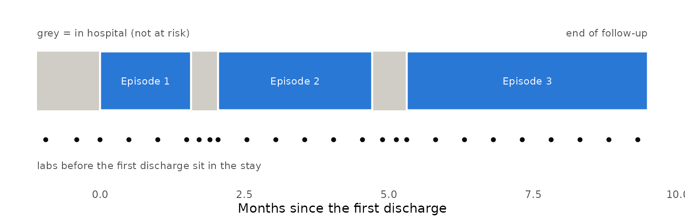
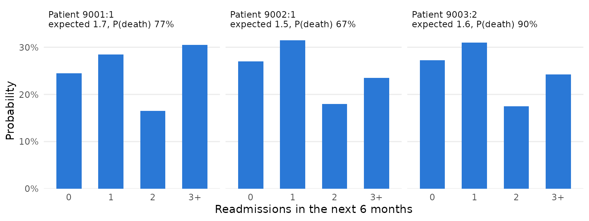

# Recurrent events: the next event and the number of recurrences

The backward joint model assumes each patient has *one* terminal event.
Many clinical processes do not: a heart-failure patient is discharged,
readmitted, discharged again, and so on, until death or the end of
follow-up. This page shows how to use BJM when events recur, using
hospital readmissions and death as the running example, and answers two
questions at a discharge:

| Question | Function |
|----|----|
| Is the **next** event a readmission or a death, and by when? | [`predictRisk()`](https://wenhaoli18.github.io/BJM/reference/predictRisk.md) |
| **How many** readmissions will there be in the next 6 months? | [`predictRecurrentCount()`](https://wenhaoli18.github.io/BJM/reference/predictRecurrentCount.md) |

## The idea: restart the clock at every discharge

Cut each patient’s history into **episodes**. An episode starts at a
discharge (time 0 on its own clock) and ends at the next readmission, at
death, or when follow-up stops. Within an episode the situation is
exactly the one BJM was built for: one event, of one of two types,
preceded by biomarker measurements. So an episode is treated as a
“patient”, with these additions:

- the clock restarts at the discharge, so a readmission’s time in
  hospital is *not* time at risk;
- labs drawn during a stay, or before the first discharge, precede the
  episode they help predict and are kept with *negative* times;
- the number of the episode (1st discharge, 2nd, …) is a covariate, so a
  patient’s earlier readmissions inform the later risk.

[`buildRecurrentEpisodes()`](https://wenhaoli18.github.io/BJM/reference/buildRecurrentEpisodes.md)
does the cutting. Everything after it is the ordinary BJM workflow.

``` r

library(BJM)
library(ggplot2)
set.seed(2026)
```

## Example data

BJM does not ship a recurrent-event data set, so we simulate a small
cohort in the shape your own data would have. The code only makes the
example data; skip to the next section if you have your own.

``` r

# One patient: time-to-readmission and type depend on age, sex, the number of
# previous readmissions and a patient-level frailty; a biomarker's trajectory
# in each episode depends on how long that episode lasts. Times are in months
# since the first (index) discharge.
simulate_patient <- function(id, follow_up = c(6, 12), max_episodes = 12) {
  age <- rnorm(1, 70, 8); sex <- rbinom(1, 1, 0.5); age_c <- (age - 70) / 10
  frailty <- rnorm(1, 0, 0.5)
  u0 <- rnorm(1, 0, 0.5) + 0.8 * frailty; u1 <- rnorm(1, 0, 0.3)
  end_of_follow_up <- if (is.null(follow_up)) Inf else runif(1, follow_up[1], follow_up[2])
  stay <- function() max(0.08, rexp(1, 1 / 0.25))        # months in hospital

  start <- 0; stay_before <- stay(); k <- 0
  events <- list(); labs <- list(); starts <- numeric(0)
  repeat {
    k <- k + 1; starts[k] <- start
    gap <- (-log(runif(1)) / (0.25 * exp(0.3 * age_c + 0.3 * sex + 0.25 * (k - 1) + frailty)))^(1 / 1.2)
    dies <- rbinom(1, 1, plogis(-2 + 0.5 * gap + 0.3 * age_c + 0.3 * (k - 1)))
    end <- start + gap
    censored <- end > end_of_follow_up
    stop_time <- if (censored) end_of_follow_up else end

    # labs: two in the stay before this discharge, one at discharge, then
    # a visit every half month while the patient is still at risk
    t <- c(start - stay_before * c(0.7, 0.3), start)
    j <- 1
    while (start + 0.5 * j < stop_time) { t <- c(t, start + 0.5 * j); j <- j + 1 }
    mean_lab <- 5 + u0 + (-0.3 + u1) * (t - start) + 0.4 * gap - 0.5 * gap * (t - start) +
      0.05 * age_c + 0.2 * sex
    labs[[k]] <- data.frame(id = id, t = t, biomarker = rnorm(length(t), mean_lab, 0.4))

    row <- function(time, status, discharge = NA_real_)
      data.frame(id = id, time = time, status = status, discharge = discharge, age = age, sex = sex)
    if (censored) { events[[k]] <- row(end_of_follow_up, 0L); break }
    if (dies == 1) { events[[k]] <- row(end, 2L); break }
    next_stay <- stay()
    events[[k]] <- row(end, 1L, discharge = end + next_stay)
    if (end + next_stay >= end_of_follow_up || k >= max_episodes) break
    start <- end + next_stay; stay_before <- next_stay
  }
  list(events = do.call(rbind, events), labs = do.call(rbind, labs), starts = starts)
}

cohort <- lapply(1:300, simulate_patient)
events <- do.call(rbind, lapply(cohort, `[[`, "events"))
labs   <- do.call(rbind, lapply(cohort, `[[`, "labs"))
```

You need two tables.

**`events`: one row per readmission, death or end of follow-up.**

``` r

head(events[events$id == 1, ], 5)
#>   id     time status discharge      age sex
#> 1  1 1.575685      1  2.043283 74.16471   0
#> 2  1 4.711596      1  5.309283 74.16471   0
#> 3  1 9.484838      0        NA 74.16471   0
```

`time` is when the event happened, `status` is `1` for a readmission,
`2` for a death and `0` for the end of follow-up with nothing happening,
and `discharge` is when the stay that a readmission began ends (`NA`
when there is no stay: death, or follow-up ending). Other columns are
covariates.

**`labs`: one row per measurement, on the same time axis.**

``` r

head(labs[labs$id == 1, ], 5)
#>   id          t biomarker
#> 1  1 -0.9399152  5.574503
#> 2  1 -0.4028208  4.606169
#> 3  1  0.0000000  3.231357
#> 4  1  0.5000000  3.219372
#> 5  1  1.0000000  3.522247
```

Times before 0 are labs from the first hospital stay. The picture below
shows what one patient’s data looks like once it is cut into episodes.



## Step 1: cut the history into episodes

``` r

built <- buildRecurrentEpisodes(events, labs, time_variable_long = "t",
                                restart_variable = "discharge", lookback = Inf)
```

- `restart_variable = "discharge"` starts each new episode at the
  discharge that ended the stay, not at the readmission. Leave it out
  when an event takes no time (a tumour recurrence, say) and the next
  episode simply starts at the event.
- `lookback = Inf` keeps labs drawn before an episode’s start – in the
  stay before it – as negative `time_in_episode`, but never reaching
  back past the previous event. The default, `0`, keeps only labs from
  the start on.

The result has two tables. `episode_data` has one row per episode:

``` r

head(built$episode_data[built$episode_data$id == 1, ], 6)
#>   id episode episode_id      gap event_any event_type      age sex
#> 1  1       1        1:1 1.575685         1          0 74.16471   0
#> 2  1       2        1:2 2.668313         1          0 74.16471   0
#> 3  1       3        1:3 4.175555         0         NA 74.16471   0
```

`gap` is the length of the episode, `event_any` says whether it ended in
an event (rather than the end of follow-up), `event_type` is `0` for a
readmission and `1` for a death, and `episode` counts the discharges.
The labs, re-clocked, are in `long_data`:

``` r

head(built$long_data[built$long_data$id == 1,
                     c("id", "episode", "t", "time_in_episode", "gap", "biomarker")], 6)
#>   id episode          t time_in_episode      gap biomarker
#> 1  1       1 -0.9399152      -0.9399152 1.575685  5.574503
#> 2  1       1 -0.4028208      -0.4028208 1.575685  4.606169
#> 3  1       1  0.0000000       0.0000000 1.575685  3.231357
#> 4  1       1  0.5000000       0.5000000 1.575685  3.219372
#> 5  1       1  1.0000000       1.0000000 1.575685  3.522247
#> 6  1       1  1.5000000       1.5000000 1.575685  2.684941
```

`time_in_episode` is the time since that episode’s discharge, negative
for labs in the stay before it. Note that `gap` is `NA` for an episode
that has not ended, which is how the prediction functions below
recognise a patient who is still at risk.

## Step 2: fit

This is the usual two sub-models, fit on episodes instead of patients.
The survival sub-model uses `gap` as the time and `event_any` as the
event, with the episode number as a covariate; the biomarker model is
fit on the episodes that ended in an event, as with `pbc3`.

One choice matters: **group the biomarker model’s random effects by
episode (`episode_id`), not by patient (`id`)**. A patient’s biomarker
level is generally different at the start of each episode, because the
underlying trajectory keeps moving, so one random effect per patient is
the wrong unit; each episode is its own “subject”, as it already is in
the survival sub-model. In a simulation in which the biomarker’s current
level drives the risk, grouping by patient left BJM clearly behind a
plain logistic regression on the last lab value (AUC for a readmission
within a month 0.65 against 0.75); grouping by episode closed the gap
(0.75 against 0.75).

``` r

surv_fit <- survivalSub(built$episode_data, Surv(gap, event_any) ~ age + sex + episode,
                        event_type ~ gap + age + sex + episode)

long_fit <- longitudinalSub(built$long_data[built$long_data$event_any == 1, ],
                            biomarker ~ time_in_episode + age + sex + gap + gap:time_in_episode,
                            ~ time_in_episode | episode_id)
```

## Step 3: describe the patients to predict for

A new patient is described in the same two-table form, up to *now*:
their earlier readmissions, then one last row saying “no event yet as of
now”, and their labs so far. Here are three patients who have just been
discharged, two for the first time and one for the second.

``` r

history_at_discharge <- function(p, k) {
  now <- p$starts[k]
  ev <- p$events[seq_len(k - 1), ]                       # earlier readmissions
  last <- data.frame(id = p$events$id[1], time = now + 0.001, status = 0L, discharge = NA_real_,
                     age = p$events$age[1], sex = p$events$sex[1])
  list(events = rbind(ev, last), labs = p$labs[p$labs$t <= now, ])
}

set.seed(7)
fresh <- lapply(5001:5040, simulate_patient, follow_up = NULL)
reach2 <- Filter(function(p) length(p$starts) >= 2, fresh)      # patients with a 2nd discharge
chosen <- list(
  list(p = fresh[[1]], k = 1), list(p = fresh[[2]], k = 1), list(p = reach2[[1]], k = 2))
histories <- lapply(chosen, function(x) history_at_discharge(x$p, x$k))
for (i in seq_along(histories)) {                        # give each prediction its own id
  histories[[i]]$events$id <- histories[[i]]$labs$id <- 9000 + i
}
now_events <- do.call(rbind, lapply(histories, `[[`, "events"))
now_labs   <- do.call(rbind, lapply(histories, `[[`, "labs"))

now <- buildRecurrentEpisodes(now_events, now_labs, time_variable_long = "t",
                              restart_variable = "discharge", lookback = Inf)
# each patient's last episode is the one still open
open <- now$long_data[now$long_data$episode == ave(now$long_data$episode, now$long_data$id, FUN = max), ]
head(open[, c("episode_id", "t", "time_in_episode", "gap", "biomarker", "event_type")], 4)
#>   episode_id           t time_in_episode gap biomarker event_type
#> 1     9001:1 -0.14213393     -0.14213393  NA  5.387458         NA
#> 2     9001:1 -0.06091454     -0.06091454  NA  5.468732         NA
#> 3     9001:1  0.00000000      0.00000000  NA  6.263731         NA
#> 4     9002:1 -0.05600000     -0.05600000  NA  5.488383         NA
```

The open episode’s `gap` and `event_type` are `NA`, as they must be:
what happens in it is what we are predicting. Each `episode_id` appears
once, so each prediction is its own “subject”; if you want predictions
for the same patient at several discharges, give each its own `id` (the
discharges here already differ in `episode`, but the ids you pass in
should not repeat).

## Step 4: the next event

[`predictRisk()`](https://wenhaoli18.github.io/BJM/reference/predictRisk.md)
is used exactly as before. `prediction_time = 0` is the discharge; if
you predict some time after it, give the time elapsed since the
discharge, and include the labs up to then.

``` r

risk <- predictRisk(open, long_fit, surv_fit, prediction_time = 0, horizon = 1,
                    time_variable = "time_in_episode",
                    survival_variable_all = list(), survival_trans_function = list())
round(data.frame(readmission = risk$risk_prob_1, death = risk$risk_prob_2), 3)
#>        readmission death
#> 9001:1       0.413 0.108
#> 9002:1       0.327 0.068
#> 9003:2       0.509 0.171
```

These are the probabilities that the *next* event happens within a month
and is a readmission, or a death. A longer `horizon` gives, for
instance, the probability of at least one readmission in 3 months.

## Step 5: the number of readmissions

[`predictRecurrentCount()`](https://wenhaoli18.github.io/BJM/reference/predictRecurrentCount.md)
simulates each patient forward, episode by episode, and counts. The
first episode is drawn given the patient’s labs (the same distribution
[`predictRisk()`](https://wenhaoli18.github.io/BJM/reference/predictRisk.md)
uses); later ones are drawn from the model given the patient’s
covariates, with the episode number advanced. BJM has no model of how
long a stay lasts, so you supply observed stay lengths, which are
resampled.

``` r

stay_lengths <- with(events, discharge[status == 1] - time[status == 1])
count <- predictRecurrentCount(open, long_fit, surv_fit, prediction_time = 0, horizon = 6,
                               time_variable = "time_in_episode", stay_lengths = stay_lengths,
                               n_sim = 400, max_stages = 30, seed = 1)
count
#> Predicted recurrences in (0, 6], 3 patient(s), 400 simulated paths each
#> mean expected count 1.624; P(>=1) 0.738; P(>=2) 0.434; P(death) 0.779
#> 
#>  episode_id mean_count p_count_0 p_count_1 p_count_2 p_count_3plus p_ge1 p_ge2
#>      9001:1       1.74     0.245     0.285     0.165         0.305 0.755 0.470
#>      9002:1       1.53     0.270     0.315     0.180         0.235 0.730 0.415
#>      9003:2       1.60     0.273     0.310     0.175         0.242 0.728 0.417
#>  p_death
#>    0.772
#>    0.667
#>    0.897
```

The simulated mortality here is far higher than in real heart failure,
so read the output as a format, not as clinical numbers. `count$summary`
has the expected number of readmissions, the probability of at least one
or two, and the probability of dying in the window; `count$counts` holds
every simulated path if you want a different summary. The figure shows
the whole distribution for each patient.



## Things to watch for

- **Time units.** Use one unit throughout (here months). `horizon`, the
  labs’ times and `stay_lengths` must all be in it.
- **`max_stages`.** Paths are stopped after this many episodes; the
  function warns, and sets `count$capped`, when that happens. Raise it
  for long windows or high-risk patients.
- **Covariates that change by episode.** The episode number is advanced
  for you. If your survival model uses other episode-specific
  covariates, such as the length of the previous gap, pass
  `next_covariates = function(row, k)` to update them.
- **The outcome columns must exist** in the prediction data. When it
  comes from
  [`buildRecurrentEpisodes()`](https://wenhaoli18.github.io/BJM/reference/buildRecurrentEpisodes.md)
  they do (as `NA`); if you build it by hand, add them.

## What this assumes, and what it has been checked against

- Within an episode, the model is the backward joint model, and carries
  its assumptions. Across episodes, patients are linked only through
  their covariates and the episode number: **only the first step of the
  count prediction uses the patient’s biomarkers**, and a patient-level
  tendency to recur that is not in the covariates (a frailty) is not
  carried forward.
- The stay length is resampled from the data, independently of
  everything else.
- The survival sub-model treats a patient’s episodes as independent. Its
  coefficients are still estimates of the gap-time model, but the
  standard errors in `summary(surv_fit)` ignore the correlation between
  a patient’s episodes and are too small.
- Checks so far are simulations (kept outside the package): ordinary BJM
  with one discharge per patient; several hospitalizations per patient,
  with and without a patient-level frailty; and the count prediction. In
  them, the predicted probabilities of the next event and the expected
  counts were close to the truth, and ranked patients better than
  logistic and Poisson regressions on the last lab value. A frailty
  weakened the next-event predictions (calibration slopes fell from
  about 0.95 to 0.75-0.90). A joint frailty model from the `frailtypack`
  package, which uses event history but no biomarkers, ranked patients
  much worse; a frailty model *with* biomarkers (`trivPenal()`) could
  not be compared, as it was too slow and does not fit labs measured
  afresh at each discharge. The simulated disease is not calibrated to
  any real one.
- Nothing here has been checked on real data.
